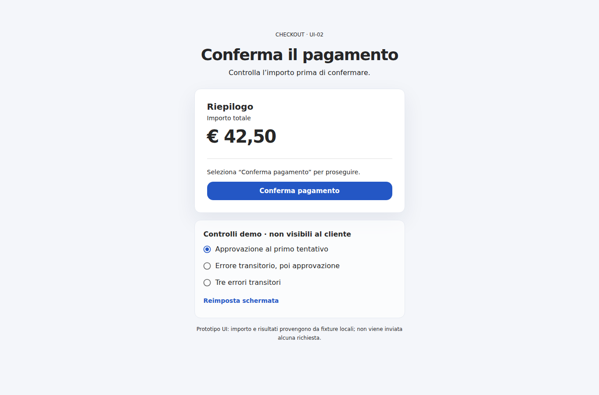

# M06 — Prototipo UI-02

Questa pagina React rende cliccabili i quattro stati del checkout UI-02 con fixture locali. Serve a discutere layout, testo e accessibilità prima di collegare API o gateway. **Non completa né spunta il task UI-02**: i prerequisiti `UI-01`, `DEC-02` e `PAY-02` restano da verificare nel piano di implementazione.



## Avvio

```bash
npm ci
npm run dev
```

Aprire l'indirizzo locale mostrato da Vite. Per verificare che il bundle venga generato:

```bash
npm run build
```

## Prova interattiva

1. Lascia selezionata **Approvazione al primo tentativo** e premi **Conferma pagamento**.
2. Seleziona **Errore transitorio, poi approvazione**, premi **Reimposta schermata**, quindi conferma.
3. Seleziona **Tre errori transitori**, reimposta e conferma per vedere lo stato di errore.
4. Durante lo stato in corso, osserva l'indicatore e verifica che la conferma non sia ripetibile.
5. Riduci la larghezza della finestra e naviga i controlli con Tab e la tastiera.

I controlli scenario sono strumenti del prototipo e non fanno parte dell'interfaccia cliente. L'importo è un dato dimostrativo. Il testo dell'esito negativo segue il requisito del caso guida che suggerisce un metodo di pagamento alternativo; `DEC-02` deve ancora approvare il contratto e i messaggi definitivi.

## Uso di Material UI MCP

Il server `mui` è configurato globalmente in Codex. Durante questa sessione `fetchDocs` è stato usato per consultare la documentazione Card; i riferimenti per i componenti usati sono [Card](https://mui.com/material-ui/react-card/), [Button](https://mui.com/material-ui/react-button/), [Progress](https://mui.com/material-ui/react-progress/) e [Alert](https://mui.com/material-ui/react-alert/). Il codice è stato scritto e adattato da Codex; non usa `generateReactCode` e non richiede `MUI_RECIPES_API_KEY`.

MUI e gli altri pacchetti sono dipendenze di build del prototipo. L'MCP è uno strumento di progettazione, non una dipendenza dell'applicazione.

## Decisioni ancora aperte

- Confermare layout, microcopy e importo fittizio con il team.
- Allineare i dati degli stati alla risposta API decisa in `DEC-02`.
- Riutilizzare le versioni qui fissate solo dopo la decisione `DEC-01`.
- Integrare il comportamento del backend soltanto nel task `UI-03`.
